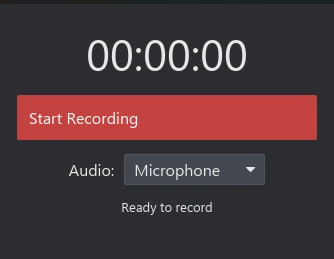

# rsecord

A lightweight, cross-platform screen recorder built with Rust and [iced](https://iced.rs). It records your screen and audio straight to MP4 with no external FFmpeg.

## Features

- H.264 video (OpenH264) and AAC-LC audio (FDK-AAC), muxed into a single MP4
- **Record a selected area**: a full-screen overlay lets you draw, move and resize the capture box, or type exact X / Y / W / H pixels
- **Fine-grained video quality**: every number is editable (see below), with one-click presets
- Choose which display to record
- Audio source: none, microphone, or system audio (Windows; Linux via a monitor source; macOS via BlackHole)
- Live recording timer, status line, and a running estimate of output size and bitrate
- **Themes**: 10 built-in themes plus "Follow system" (light or dark with your OS). The default is the rsecord Dark theme. Pick one in **Settings > Theme**; it is saved automatically
- Live input checking: an invalid number is outlined in red with the reason, and recording cannot start until it is fixed
- Settings are remembered between runs

 

  

## Recording a selected area

1. Switch **Capture area** to **Selected area**.
2. Click **Select area on screen...**. rsecord hides itself, freezes a screenshot of the chosen display, and shows it full screen.
3. Drag on empty space to draw a box. Drag inside the box to move it. Drag an edge or corner handle to resize it. A label shows the exact size and position in pixels.
4. Press **Enter** (or **Confirm**) to accept, **Esc** (or **Cancel**) to abort. **Select all** selects the entire display.

The area is stored in physical pixels, so it is exact on high-DPI screens. You can fine-tune it afterwards by typing X / Y / W / H. If you pick the overlay again, the current box is shown so you can adjust it. Width and height are rounded down to even numbers (an H.264 requirement), with a minimum of 16 x 16.

## Video quality settings

| Setting | Range | Notes |
|---|---|---|
| Preset | Low / Balanced / High / Ultra / Custom | Editing any value switches to Custom |
| Frame rate | 1 - 120 fps | quick buttons for 15 / 24 / 30 / 60 / 120 |
| Resolution | same as source, 2160p / 1440p / 1080p / 720p / 480p / 360p, percent, custom W x H | fixed-height presets never upscale; custom size can keep the aspect ratio |
| Scaling filter | Nearest, Bilinear, Bicubic, Lanczos | only used when the output is resized |
| Content type | Screen / UI, Camera / motion | encoder tuning hint |
| Rate control | Target bitrate, Quality (QP range) | |
| Bitrate | auto (bits per pixel, 0.01 - 2.0) or manual 100 - 100000 kbps | |
| QP range | 0 - 51 (min and max) | lower = better quality |
| Encoder effort | Fast, Balanced, Best quality | CPU vs. quality |
| Keyframe interval | 0.2 - 60 s | |
| Threads | 0 (auto) - 64 | |
| Toggles | skip frames, adaptive quantization, background detection, scene-change detection | |
| AAC bitrate | 32 - 320 kbps | |

Invalid numbers are outlined in red with the reason right under the field, and recording will not start until they are fixed. The record page tells you what is wrong and has a **Fix** button that jumps to the right tab.

Settings are stored in `settings.conf` inside the `rsecord` folder of your OS config directory (for example `%APPDATA%\rsecord` on Windows, `~/.config/rsecord` on Linux).

## Themes

| Theme | Style |
|---|---|
| Follow system | rsecord Light or Dark, following your OS setting |
| rsecord Dark / rsecord Light | The default look, from the app icon colors |
| Midnight (OLED) | Pure black background |
| Nord, Dracula, Catppuccin Mocha / Latte, Tokyo Night, Gruvbox Dark, Solarized Light | Popular palettes |

Every color in the UI comes from the active theme. Text on buttons and badges is chosen automatically for readability, and a unit test checks WCAG AA contrast (4.5:1) for every theme.

## Keyboard

| Key | Action |
|---|---|
| Tab / Shift+Tab | Move between input fields |
| Esc | Leave Settings, or cancel the area selector |
| Enter | Confirm the area selector |

## Output

Files are saved to `Videos/rsecord/`, falling back to `~/rsecord/` if the Videos folder is unavailable.

Filename format: `rsecord-YYYY-MM-DD_HH-MM-SS.mp4`

## Requirements

- Rust 1.85 or newer (edition 2024)
- A C/C++ compiler and CMake (used to build OpenH264 and FDK-AAC)
- Linux only: development packages for ALSA, XCB, XRandR, D-Bus, PipeWire, Clang, and pkg-config

## Usage

1. Pick the display, capture mode (full screen or selected area) and audio source.
2. Pick a quality preset or adjust the numbers.
3. Click **Start Recording**, then **Stop** to finish. The file is written and its path is shown in the status line.

Settings are locked while recording. Closing the window during a recording, or while the file is being written, finishes and saves the file first. After a recording, **Open folder** shows where it was saved.

## Platform notes

| Platform | Screen | Microphone | System audio                          |
|----------|--------|------------|---------------------------------------|
| Windows  | Yes    | Yes        | Yes                                   |
| Linux    | Yes    | Yes        | Yes, via a PulseAudio/PipeWire monitor |
| macOS    | Yes    | Yes        | Requires a virtual device (BlackHole) |

The area selector uses a normal full-screen window, so it works without compositor transparency. On Wayland, the window manager may ignore the request to stay on top or to place the overlay on a specific monitor; the selected pixels are still correct because they are measured on the screenshot.

## License

Released under the [MIT License](LICENSE). Copyright (c) 2026 TamKungZ_.

FDK-AAC carries licensing and patent considerations of its own. Review the applicable terms before commercial distribution.
